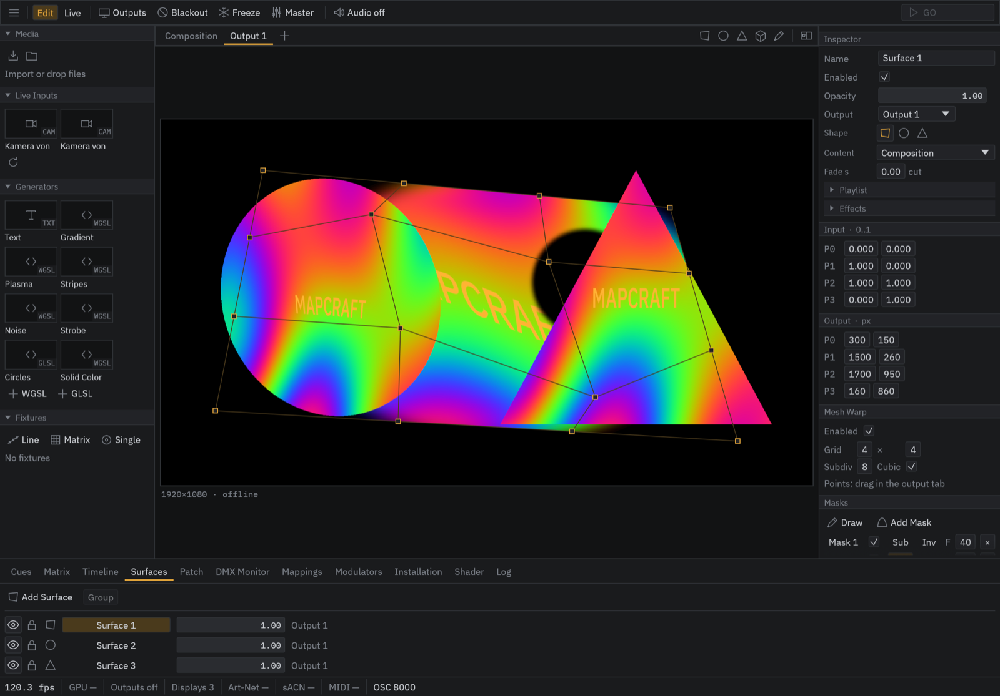
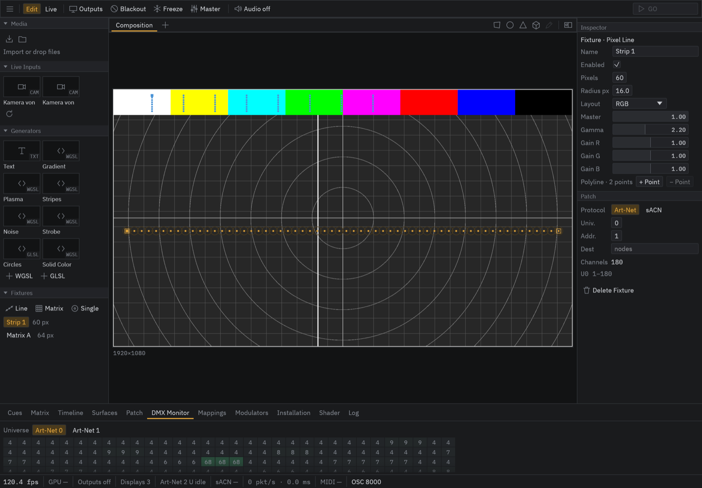
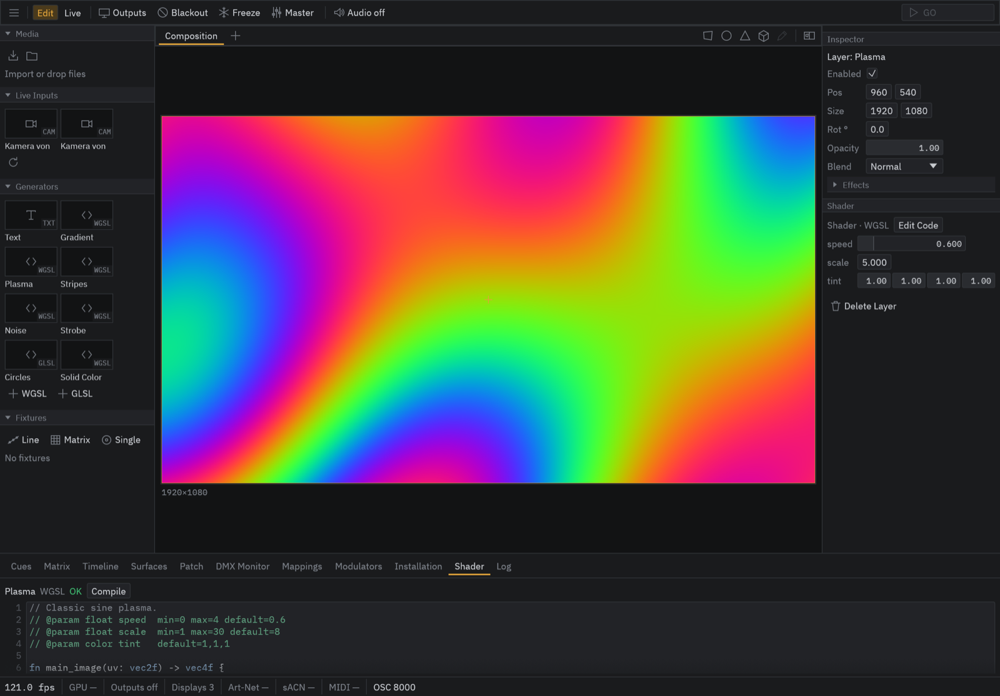

# MapCraft (working title)

**Projection mapping and LED pixel mapping for macOS – early alpha.**

> **Early alpha.** This is a test build, not a finished product. It has not
> yet been tested with every kind of projector, LED controller or MIDI
> device. Expect bugs and changes, keep backups of your projects, and do not
> rely on it for a show without a fallback. The name is a working title.

MapCraft puts video onto any surface and drives LEDs and DMX fixtures from the
same image. It is built for technicians, small crews and artists working on
installations, clubs, theatre and events: dense, dark and quiet to work with
at the desk, and stable in live operation.

## What it does

**Mapping**
- One central composition (up to 16K) with layers, blend modes and effects.
- Surfaces as quads with 4-point perspective correction, ellipses, polygons,
  mesh warp (linear or curved) and Bézier masks with soft edges.
- Several outputs (projectors, displays) with edge blending, colour correction
  and per-output delay; Syphon in and out.
- Projection onto 3D objects: load an OBJ or glTF model and calibrate it from
  six or more points.

**Media**
- Images, video (H.264, HEVC, ProRes, HAP on the GPU), cameras, text, and live
  shaders in WGSL or GLSL with parameters that appear automatically.
- Media library with thumbnails; playlists per surface; loop, hold and
  pendulum playback.

**LED and DMX**
- Pixel lines, pixel matrices and single fixtures sample the composition.
- RGB, GRB, BRG, RGBW and dimmer layouts, gamma and white balance per fixture.
- Output over Art-Net (with node discovery) and sACN at a steady rate,
  independent of the frame rate. DMX monitor with live values.

**Show control**
- Cue list with fades and auto-follow, a scene matrix, and a timeline with
  clips, automation and markers.
- MIDI and OSC with learn mode and controller feedback; MIDI and LTC timecode;
  beat detection from an audio input.
- LFO modulators, master levels, blackout, freeze, and a live mode that locks
  the setup during the show.
- Installation mode: open a show at start-up, weekly schedule, projector
  control over PJLink.

## Requirements

- A Mac with Apple Silicon (M1 or newer)
- macOS 13 Ventura or newer

Windows and Linux builds are planned but not available yet.

## Download and install

Download one of the files from the [`downloads`](downloads/) folder:

- **`MapCraft-0.1.0-macOS-arm64.dmg`** – open it and drag MapCraft into
  *Applications*.
- **`MapCraft-0.1.0-macOS-arm64.pkg`** – double-click it; the installer puts
  MapCraft into *Applications*.

Checksums are in [`downloads/SHA256SUMS.txt`](downloads/SHA256SUMS.txt).

**First start:** The app is not yet notarized by Apple, so macOS says it cannot
check it.
1. Open MapCraft once and close the message.
2. Go to *System Settings › Privacy & Security* and choose **Open Anyway**
   next to MapCraft.

macOS then asks for access to the local network (needed for Art-Net, sACN and
OSC), and later for the camera or microphone only if you use one.

The log file is at `~/Library/Logs/MapCraft/mapcraft.log`.

## Status

This is version 0.1.0, the first alpha. Known limitations include:

- The grid and colour-bar test images do not yet show edge blending.
- The source → output latency has not been measured on real hardware.
- No Apple notarization yet (see *First start*).

The source code is not public at this time.

## Feedback

Bug reports and observations are very welcome – please open an issue in this
repository. The most useful reports say what you did, what you expected, what
happened, and include the log file.

## Third-party software

MapCraft includes FFmpeg 9.0.2, licensed under the GNU LGPL 2.1 and linked
dynamically. Its source code is available at
<https://ffmpeg.org/releases/ffmpeg-9.0.2.tar.xz>. The interface uses the IBM
Plex Sans and Plex Mono fonts under the SIL Open Font License 1.1. All license
texts are in [`licenses/`](licenses/) and inside the app
(*MapCraft › Show Package Contents › Contents/Resources/Licenses*).
